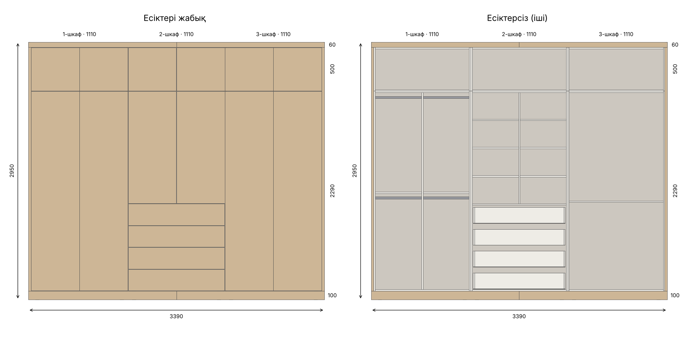

# Спальный шкаф 3390 × 2950 × 600

ЛДСП 16 мм · 3 шкаф · 6 есік · 4 сыртқы суырма · 3 антресоль (Tip-On есіктер)



## Файлдар
| Файл | Не үшін |
|---|---|
| `shkaf.rb` | SketchUp (Mac/Windows, desktop) — шкафты автоматты түрде сызады, тегтері мен түстерімен |
| `shkaf.dae` | Қосалқы нұсқа: SketchUp > Файл > Импорт > COLLADA (.dae) |
| `preview.png` | Алдынан көрініс (есікпен / есіксіз) |
| `generate.py` | Өлшемдерді өзгерткенде барлық файлды қайта жасайды: `python3 generate.py` |

## SketchUp-қа салу (shkaf.rb)
1. `shkaf.rb` файлын **Загрузки (Downloads)** қалтасына сақтаңыз.
2. SketchUp-та жаңа файл ашыңыз (шаблон: **Миллиметры**).
3. **Extensions (Расширения) → Developer → Ruby Console** ашыңыз
   (ескі нұсқаларда **Window → Ruby Console**).
4. Мына жолды көшіріп, Enter басыңыз:
   ```ruby
   load File.join(Dir.home, 'Downloads', 'shkaf.rb')
   ```
5. Шкаф өзі сызылады. Тегтер (Tags) панелінде **«Фасад»** тегін өшірсеңіз, ішкі бөлімдер көрінеді.

## Ішкі бөлімдер
- **1-шкаф:** ортасынан бөлінген, әр жағында 2 штанга (барлығы 4), арасында сөре (1100 мм).
- **2-шкаф:** төменде 4 сыртқы суырма (250 мм), үстінде 2 есік, ортасынан бөлінген, екі жағында 3 сөреден.
- **3-шкаф:** төсек-орын, 1000 мм-де бір сөре.
- **Антресольдер:** бос, есіктері Tip-On.
